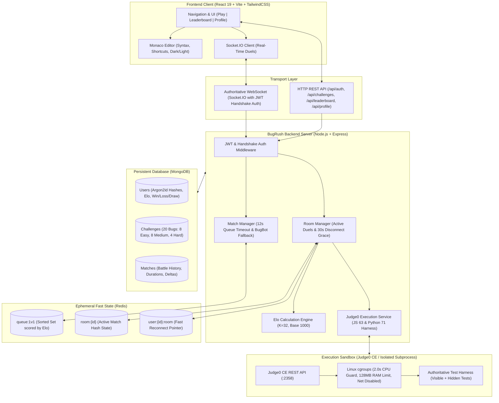

# ⚡ BugRush — Real-Time 1v1 Multiplayer Coding Duel Arena

[](https://nodejs.org/)
[](https://react.dev/)
[](https://tailwindcss.com/)
[](https://microsoft.github.io/monaco-editor/)
[](https://socket.io/)
[](https://redis.io/)
[](https://www.mongodb.com/)
[](https://judge0.com/)

**BugRush** is a competitive, real-time multiplayer speed-debugging platform. Two developers enter an arena, face the exact same broken codebase in a Monaco Editor, and race head-to-head to locate the bug, repair the code, and pass all test cases. Code runs inside an isolated **Judge0 CE sandbox** with strict CPU/memory quotas. The first player whose submission satisfies all visible and hidden tests wins the duel and climbs the global **Elo ranked ladder ($K=32$)**.

---

## 🏗️ Architecture Overview

The platform is designed with an authoritative server model: clients render the IDE, capture keystrokes, and visualize test results, but all matchmaking, room timers, sandbox executions, and Elo rating math happen authoritatively on the server.



### State Ownership Separation

| Store | State Lifetime | Keys / Collections | Purpose |
| :--- | :--- | :--- | :--- |
| **MongoDB** | Permanent | `users`, `challenges`, `matches` | Authoritative persistence: user accounts with Argon2id passwords, 20 debugging problems, and complete match logs. |
| **Redis** | Ephemeral | `queue:1v1`, `room:{id}`, `user:{id}:room` | High-throughput sub-millisecond state: matchmaking queues, live test pass counters, and reconnect mappings. |
| **Judge0 CE** | Ephemeral Task | CPU limit 2s, RAM 128MB | Untrusted code execution in an isolated Linux container with outbound networking disabled. |

---

## 🔒 Security Design

> **Core System Security**: Untrusted user code is executed hundreds of times per minute during competitive matches. BugRush enforces multi-layered isolation, zero-trust test delivery, and rate limiting.

### 1. Judge0 CPU & Memory Isolation
Untrusted user code is submitted to **Judge0 CE** (or the isolated fallback runner) with strict containment parameters:
- **CPU Time Limit (`cpu_time_limit: 2.0s`)**: Every submission is bounded by an operating-system level CPU timer. Infinite loops (e.g., `while (true) {}`) or catastrophic regular expression backtracking are aborted via `SIGXCPU` / `SIGKILL` after 2000ms.
- **Memory Ceiling (`memory_limit: 128000 KB`)**: The container process is restricted to 128 MB of memory. Malicious memory allocation attacks (e.g., allocating oversized arrays or infinite string concatenation) trigger an immediate `SIGSEGV` or memory limit error without starving the host OS.
- **Network Isolation (`network_disabled: true`)**: Sandbox containers run with all network interfaces disabled (`--network none`). User code cannot initiate socket connections, issue outbound HTTP requests, perform SSRF against cloud metadata endpoints, or open reverse shells.
- **Subprocess Fallback Containment**: In offline or local development mode without Docker, the server executes submissions via isolated child processes using Node.js `--max-old-space-size=128` and Python `time.perf_counter()` watchers guarded by an external 2.2-second timeout monitor.

### 2. Authoritative Hidden Test Stripping
A primary vulnerability in online competitive coding is client-side test scraping. BugRush guarantees that hidden tests cannot be extracted:
- **Zero-Trust Client Delivery**: When a duel starts (`match:start`), the server transmits **only** the `buggyCode` and the 2 `visibleTests`. The 4 `hiddenTests` are never delivered to the client socket.
- **Server-Side Test Harness Injection**: The server takes the user's submitted code and injects both visible and hidden test suites into an authoritative, enclosed test runner (`server/services/judge0.js`).
- **Cryptographic Result Stripping**: Upon test execution, the server intercepts the output and **sanitizes all hidden test artifacts**:
  ```javascript
  // Process hidden tests: STRIP INPUT, EXPECTED, RECEIVED & ERROR DETAILS!
  const hiddenResults = (parsed.hiddenResults || []).map((t, idx) => ({
    id: t.id,
    name: `Hidden Test #${idx + 1}`,
    passed: Boolean(t.passed),
    executionTimeMs: t.executionTimeMs || 0,
    isHidden: true
    // Explicitly omitted: input, expected, received, error traces
  }));
  ```
  The submitting client receives only `passed: true/false` and execution time for hidden tests, preventing algorithmic reverse-engineering.

### 3. Submission Rate Limiting & Input Validation
- **Submission Throttling**: Players cannot flood the Judge0 execution queue. The server enforces a cooldown window (maximum 1 submission per 2–3 seconds per user). Rapid-fire requests are rejected with a `429 Too Many Requests` or `RATE_LIMITED` socket event.
- **Payload Size Capping**: Code submissions are validated against a 10 KB size limit. Oversized payloads designed to exhaust memory or parser buffers are dropped before reaching the execution pipeline.
- **Log Interception**: `console.log` (JS) and `sys.stdout` (Python) are redirected inside the test harness to internal memory buffers, preventing delimiter spoofing or stdout hijacking.

### 4. Authentication & Password Security
- **Argon2id Cryptographic Hashes**: Passwords in the `User` model are hashed using `argon2id` with `memoryCost: 65536` ($2^{16}$ KB), `timeCost: 3`, and `parallelism: 1`. This provides state-of-the-art resistance against GPU cracking and side-channel timing attacks.
- **JWT Socket.IO Handshake Authentication**: WebSockets verify standard JWT tokens during the handshake phase (`io.use`). Anonymous guest sessions are assigned signed temporary identifiers to prevent socket identity spoofing.

---

## 🐳 Local Docker Setup Instructions

BugRush includes a production-ready `docker-compose.yml` to spin up MongoDB, Redis, and Judge0 CE locally with a single command.

### 1. Prerequisites
- [Docker Desktop](https://www.docker.com/products/docker-desktop/) (v20.10+ / Docker Compose v2+)
- [Node.js](https://nodejs.org/) v18 or v20+

### 2. Start Services via Docker Compose
From the project root:
```bash
docker-compose up -d
```

This starts the following container services:
- **`bugrush-mongo`**: MongoDB 6.0 listening on `localhost:27017`
- **`bugrush-redis`**: Redis 7.0 Alpine listening on `localhost:6379`
- **`bugrush-judge0-server`**: Judge0 CE v1.13.0 API listening on `localhost:2358`
- **`bugrush-judge0-db`**: PostgreSQL 13 backend for Judge0 on `localhost:5432`
- **`bugrush-judge0-redis`**: Redis queue worker for Judge0

### 3. Verify Container Health
Verify all containers are running:
```bash
docker-compose ps
```

Test service connectivity:
```bash
# Verify Redis
docker exec -it bugrush-redis redis-cli ping
# Output: PONG

# Verify MongoDB
docker exec -it bugrush-mongo mongosh --eval "db.adminCommand('ping')"
# Output: { ok: 1 }

# Verify Judge0 Sandbox
curl http://localhost:2358/system_info
# Output: JSON system details
```

### 4. Configure Environment Variables
Ensure `server/.env` contains:
```env
PORT=5000
MONGODB_URI=mongodb://127.0.0.1:27017/bugrush
REDIS_URL=redis://127.0.0.1:6379
JWT_SECRET=BugRushSecretKey2026!
JUDGE0_URL=http://localhost:2358
CLIENT_URL=http://localhost:5173
```

### 5. Seed the Challenge Bank & Ranked Ladder
In a new terminal:
```bash
cd server
npm install
npm run seed
```
This inserts **20 JavaScript debugging challenges** (8 Easy, 8 Medium, 4 Hard), ranked players, and initial match history into MongoDB.

### 6. Run Server & Client Locally
```bash
# Terminal 1: Backend Server
cd server
npm run dev

# Terminal 2: Frontend Client
cd client
npm install
npm run dev
```
Open **`http://localhost:5173`** in your browser.

---

## 🤖 BugBot: Intelligent Simulated Opponent

To ensure zero matchmaking wait times, BugRush features **BugBot** ([server/sockets/matchManager.js](file:///d:/BugRush/server/sockets/matchManager.js)):

1. **12-Second Queue Timeout**: When a player clicks **Find Match**, they enter `queue:1v1`. If no human opponent within the rating window is found after **12 seconds**, the system automatically matches the player against BugBot.
2. **Dynamic Rating Matching**: BugBot's rating is automatically calculated within **$\pm 50$ Elo points** of the player's current rating (`playerRating + random(-50, +50)`), ensuring fair competition.
3. **Simulated Human Progression**: BugBot incrementally solves test cases every **15 to 25 seconds** (`15000ms + random(10000ms)`), broadcasting live `opponent:progress` updates to the player's screen.
4. **Authoritative Resolution**: If the player takes too long and BugBot passes all test cases, BugBot solves the challenge and wins the match. If the player submits a working solution first, the player wins immediately and BugBot cancels its timer.

---

## ⚡ Load Testing (`loadtest.js`)

BugRush includes a load testing script ([loadtest.js](file:///d:/BugRush/loadtest.js)) simulating **25 concurrent 1v1 matches (50 players)**.

### Running the Load Test
Make sure the server is running on `http://localhost:5000`, then run:
```bash
# From project root:
node loadtest.js

# Or with custom match counts:
node loadtest.js --matches=25 --url=http://localhost:5000

# Or via npm in server/:
cd server
npm run loadtest
```

### What `loadtest.js` Simulates:
1. Spawns **50 concurrent Socket.IO clients** across 25 distinct rating tiers.
2. Emits `queue:join` and captures matchmaking pairing latencies (`queue:join` $\rightarrow$ `match:found`).
3. Waits for `match:start` and simulates realistic human typing delays (200–800ms).
4. Emits `code:run` with code solutions to trigger concurrent sandboxed evaluations.
5. Captures roundtrip code evaluation latencies (`code:run` $\rightarrow$ `run:result`), verifies test passes, and measures match completion.

### Sample Benchmark Results
```
===============================================================
📊  LOAD TEST RESULTS & BENCHMARK SUMMARY  📊
===============================================================
 Target Server               : http://localhost:5000
 Total Test Duration         : 7.01s
 Target 1v1 Matches          : 25
 Total Simulated Players     : 50
 Connected Sockets           : 50 / 50
 Queue Placements            : 50 / 50
 Matches Established         : 25 / 25 (Total match:found events: 50)
 Unique Match Rooms Active   : 25
 Code Runs Submitted         : 50
 Code Runs Evaluated         : 50
 Unhandled Errors            : 0
---------------------------------------------------------------
⏱️  LATENCY BENCHMARKS
---------------------------------------------------------------
Matchmaking Pairing Latency (Queue Join -> match:found):
  - Mean    : 116 ms
  - Median  : 7 ms
  - P95     : 81 ms
  - P99     : 2614 ms

Code Evaluation Latency (code:run -> run:result):
  - Mean    : 183 ms
  - Median  : 188 ms
  - P95     : 289 ms
  - P99     : 292 ms
===============================================================
✅ PASS: Successfully handled 25 concurrent 1v1 matches with zero socket drops!
```

---

## 🔌 Authoritative Socket.IO Event Protocol

| Event | Origin | Payload Schema | Description |
| :--- | :--- | :--- | :--- |
| `queue:join` | Client | `{ rating: Number }` | Enters player into Redis `queue:1v1` sorted set. |
| `queue:joined` | Server | `{ inQueue: Boolean, rating: Number }` | Confirms queue placement. |
| `queue:leave` | Client | `none` | Cancels queue wait. |
| `queue:join_bot` | Client | `none` | Immediately initiates a match vs BugBot. |
| `match:found` | Server | `{ roomId, opponent: { name, rating, isBot }, challenge, countdownSeconds: 3 }` | Opponents locked in; shows countdown modal. |
| `match:start` | Server | `{ roomId, challenge: { buggyCode, visibleTests }, endsAt, timeLimitSeconds: 300 }` | Countdown finishes; Monaco editor unlocks. |
| `code:run` | Client | `{ roomId: String, code: String }` | Submits code for Judge0 sandbox evaluation. |
| `run:result` | Server | `{ passed, total, status, visibleResults, hiddenPassed, hiddenCount }` | Evaluation output (hidden tests stripped). |
| `opponent:progress`| Server | `{ passed: Number, total: Number }` | Broadcasts opponent test count to live progress bar. |
| `match:end` | Server | `{ winnerId, winnerUsername, reason, ratingChanges: { [userId]: { old, new, delta } } }` | Concludes match and persists Elo updates. |
| `opponent:disconnected` | Server | `{ disconnectedUserId, gracePeriodSeconds: 30 }` | Starts 30-second forfeit grace window. |
| `opponent:reconnected` | Server | `{ reconnectedUserId }` | Cancels forfeit timer upon reconnect. |

---

## 📈 Elo Rating Mathematics ($K=32$, Base 1000)

Every competitive match recalculates player ratings using standard Elo equations:

$$\text{Expected}_A = \frac{1}{1 + 10^{(R_B - R_A) / 400}}$$

$$R'_A = R_A + K \cdot (\text{Actual}_A - \text{Expected}_A)$$

- **$K$-Factor**: `32` (high-velocity competitive ranking).
- **Actual Score**: `1.0` for victory, `0.5` for draw, `0.0` for defeat.
- **Base Rating**: `1000`.

---

## 📚 20 JavaScript & Python Debugging Challenges

All challenges in [server/challenges/seed.js](file:///d:/BugRush/server/challenges/seed.js) include `functionName`, `buggyCode`, `solution`, **2 visible tests**, and **4 hidden tests**:

| # | Difficulty | Title | Function | Bug Category |
|---|---|---|---|---|
| 1 | **Easy** | Off-by-one in range sum | `sumTo` | Off-by-one (`i < n` vs `i <= n`) |
| 2 | **Easy** | Wrong Comparison in Binary Search | `binarySearch` | Wrong comparison (`low < high`) |
| 3 | **Easy** | Wrong Operator in Leap Year Calculation | `isLeapYear` | Wrong operator (`\|\|` vs `&&`) |
| 4 | **Easy** | Mutated Array in Duplicate Removal | `removeDuplicates` | Mutated array during forward `splice` |
| 5 | **Easy** | Wrong Comparison in Clamp Function | `clamp` | Inverted bounds comparison |
| 6 | **Easy** | Off-by-one in Array Chunking | `chunkArray` | Off-by-one step size (`i++` vs `i += size`) |
| 7 | **Easy** | Edge Case in Falsy Value Filtering | `compact` | Missing falsy values (`0`, `false`, `""`) |
| 8 | **Easy** | Wrong Comparison in Maximum Subarray Sum | `maxSubArray` | Initial sum failure on negative arrays |
| 9 | **Medium** | Mutated Shared State in Deep Clone | `deepClone` | Shallow `Object.assign` object mutation |
| 10 | **Medium** | Off-by-one in Flatten Array with Depth | `flattenArray` | Missing depth decrement in recursion |
| 11 | **Medium** | Async/Await Mistake in Sequential Task Runner | `fetchAllSequentially` | `forEach` with async callback ignoring promises |
| 12 | **Medium** | Wrong Operator in Merge Intervals | `mergeIntervals` | Unsorted intervals & boundary overlap |
| 13 | **Medium** | Mutated State in Object GroupBy | `groupBy` | Overwriting dictionary property keys |
| 14 | **Medium** | Async/Await Mistake in Promise Delay | `delayResolve` | Missing `await` returning unresolved Promises |
| 15 | **Medium** | Wrong Comparison in Object Deep Equality | `isDeepEqual` | Shallow comparison on nested objects |
| 16 | **Medium** | Edge Case in Word Frequency Counter | `countWordFrequency` | Prototype collision with `constructor` |
| 17 | **Hard** | Mutated State in LRU Cache Eviction | `runLRUCache` | Evicts newest instead of oldest entry |
| 18 | **Hard** | Async/Await Mistake in Promise.allSettled | `allSettledValues` | `Promise.all` failing immediately on reject |
| 19 | **Hard** | Wrong Operator in Course Schedule Cycle Detection | `findOrder` | Reversed graph edge topological sorting |
| 20 | **Hard** | Async/Await Mistake in Task Batching | `batchProcess` | Missing `await` in batch concurrency chunks |

---

## 🎨 UI Design System

Built with a light design system using:
- **Palette**: Soft Slate (`slate-50` to `slate-900`), Indigo (`#6366f1`), and Emerald (`#10b981`). Strictly zero yellow or gold tones.
- **Monaco Editor**: Integrated with custom light/dark modes, mini-map, line highlighting, and tab indentation.
- **Three Core Tabs**:
  - **Play**: Live matchmaking queue, 1v1 battle arena, split Monaco editor, console output, and opponent progress bar.
  - **Leaderboard**: Global ranked ladder fetching `GET /api/leaderboard`, ranking badges, and Elo tiers.
  - **Profile**: User stats card (`GET /api/profile/:username`), win rate chart, and recent 10-match battle history.

---

## 📄 License
MIT License. Built for real-time competitive software engineering battles.
